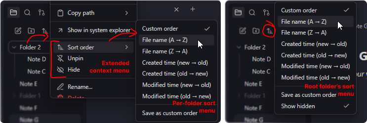

# 🗃️ Flexplorer

**Obsidian File Explorer Enhancer**

## ✨ Features

- **Custom sorting:** manually arrange items via drag-and-drop
- **Per-folder sorting:** use a different sorting mode for each folder
- **Pinning:** keep important files at the top
- **Hiding:** hide irrelevant files manually or by pattern
- **Mobile support:** works the same way on mobile

## 📥 Install

- **Via the Obsidian Community**: https://community.obsidian.md/plugins/flexplorer
- **Using the [BRAT plugin](https://github.com/TfTHacker/obsidian42-brat)**: `Add Beta Plugin` → `kh4f/flexplorer`
- **Manually**: [download](https://github.com/kh4f/flexplorer/releases/latest) `manifest.json`, `main.js`, `styles.css` into `vault/.obsidian/plugins/flexplorer/`

## 🕹️ Usage

- **Per-folder sorting:** for regular folders, select `Sort order` from the context menu. For the root folder, use the `Change sort order` button at the top of the file explorer.
- **Custom sorting:** select `Custom order` for the folder, then drag and drop items to rearrange them. On touch devices, long-press an item first.
- **Pinning:** select `Pin`/`Unpin` from an item's context menu.
- **Hiding:** select `Hide`/`Unhide` from an item's context menu, or configure `Hide patterns` in the plugin settings. To reveal all hidden items, select `Show hidden` from the root folder's sort menu.

## 💖 Credits

- **Inspiration**: [Obsidian Bartender](https://github.com/Mara-Li/obsidian-bartender), [Custom File Explorer sorting](https://github.com/SebastianMC/obsidian-custom-sort), [File Explorer++](https://github.com/kelszo/obsidian-file-explorer-plus)
- **Code contributions**: [@Mara-Li](https://github.com/Mara-Li), [@michalgregor](https://github.com/michalgregor), [@MichalNawrocik](https://github.com/MichalNawrocik)
- **Bug reports & feature requests**: [@Mara-Li](https://github.com/Mara-Li), [@Zweikeks](https://github.com/Zweikeks), [@Azmoinal](https://github.com/Azmoinal), [@SublimePeace](https://github.com/SublimePeace), [@AE-SAY-WAY](https://github.com/AE-SAY-WAY), [@Anonym0usPlayer](https://github.com/Anonym0usPlayer), [@73mtq](https://github.com/73mtq), [@toya-co](https://github.com/toya-co), [@Succubyte](https://github.com/Succubyte), [@RainyGrass](https://github.com/RainyGrass), [@akshatg](https://github.com/akshatg)